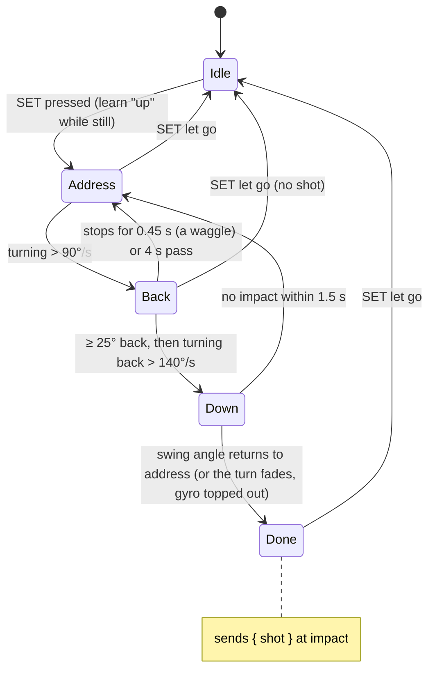
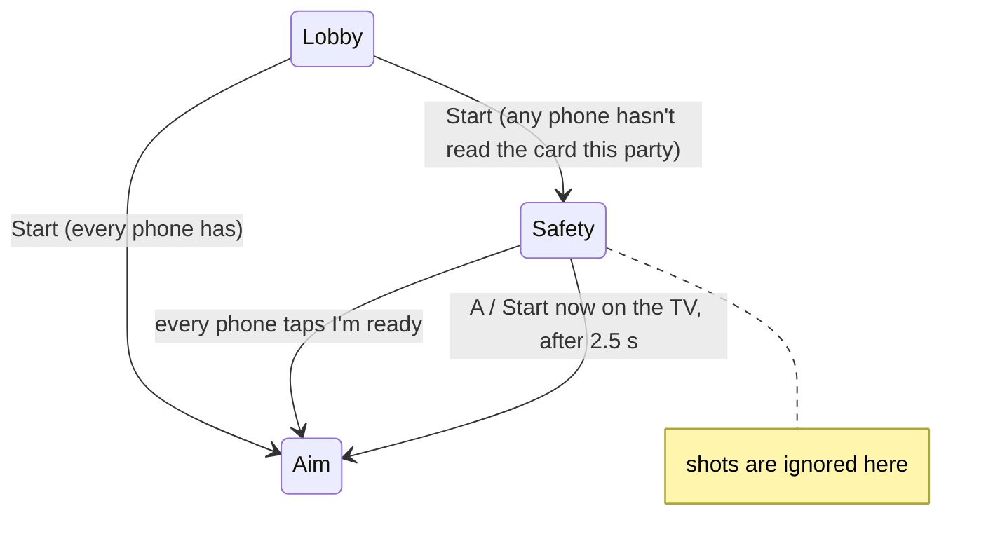
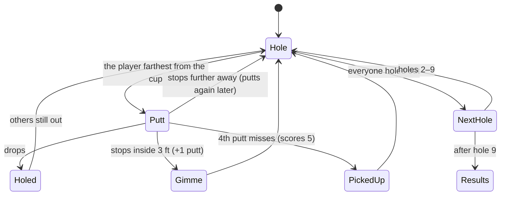

# Seaside Swing: design brief

*Called Toybox Golf until 0.5.0.*

> Your phone is the golf club: pick a club, aim, hold SET and swing for real, and a cartoon golfer smacks the ball down a 3D range. Swing hard for distance; square the club face for a pure, straight shot.

*Status: playable (driving range) · Version: 0.3.0*

## Kickoff
| Topic | Answer |
|---|---|
| Concept / genre | Arcade golf, sports party game. The TV is the course, each phone is a club |
| 2D or 3D | 3D (three.js, `--vite`) |
| Art style | A sunny ocean resort, polished and rounded (concept direction A, "Sunny Resort"). Every golfer is a bean (concept round 3): same body in their own colour, a wardrobe to choose from, and really expressive faces. **Next:** a richer course and grass (concepts M8–M10) |
| Players | Party, 1–4. Each player swings their own phone; local controllers can take a seat; "Play on this screen" is solo with the machine's own controls. Turns rotate after every shot |
| Devices | The shared screen is a Deck or handheld on a TV, a PC, or a tablet; the view fills it (1280×800 grows to 1422×800 on 16:9, 1280×960 on 4:3, no bars); phones are the clubs. Plays on: Handheld & controller, Desktop, Tablet, Party. Not Phone: a phone is the controller, never the screen, so the manifest has no `phone` field |
| Feel | Arcadey, not a simulator: tidy carries, big readable curves, a crack and a whistle on every strike |
| Camera / view | Behind the ball (golfer to one side) while aiming, a chase cam on the ball in flight, then looking down at where it stopped |
| Session and structure | Two places: the **Driving range** (Practice, endless; Target challenge, 10 balls each) and the **Putting green** (Practice, a fresh putt every turn; Putting challenge, 9 holes, fewest putts). Later: **mini golf** and **full courses** |
| Like which game? | Wii Sports golf and Topgolf (swing the controller, hit targets), but our own toy world |
| Audience and difficulty | Everyone, family couch play. "Straight shot help" defaults to Some *(assumed)* |
| Assets | All procedural: three.js primitives, generated textures *(assumed)* |
| Sound and music | Generated SFX (swish, crack, whistle, thump, target fanfares) and a bouncy loop *(assumed)* |
| Progression | Longest drive, best Target challenge score, longest holed putt and best Putting challenge per player name *(assumed)* |

## Fun targets
- **Primary: Sensation.** Your real swing becomes the shot: how hard you swing is how far it goes, the club face you bring back to the ball is whether it flies straight. A crack, a chase cam and a big yardage counter.
- **Secondary: Fellowship.** Pass-the-turn party play: everyone watches every shot, the map shows whose balls went where.
- **Tertiary: Challenge.** The Target challenge: pick the club and the power for each green, hold your face square.

## Core loop
- **Moment-to-moment:** pick a club → aim → hold SET, swing → the ball flies (curve and distance from your swing) → the readout says why
- **Round:** Practice: one shot each, round and round. Target challenge: 10 balls each, five greens worth ×1 to ×3
- **Meta:** longest drive and best challenge per player; later, mini golf and courses

## The 8 formal elements
| Element | This game |
|---|---|
| Players | 1–4, turn-based, one shared range |
| Objectives | Practice: hit it far and straight. Targets: score the most points in 10 balls. Putting: hole it; the Putting challenge in the fewest putts over 9 holes |
| Procedures | Club (7 clubs), aim (±30°), swing (phone motion, or the meter / flick fallbacks). Putting: the putter only, aim ±25° off the line to the cup, a putting stroke |
| Rules | Distance = club × power (a full swing carries the club's distance, past full goes a little further and wilder). Start direction ≈ face, curve = face − path. Target points: where the ball first lands; ring points (30 / 20 / 10) × green multiplier (×1 at 60 yd to ×3 at 220 yd) |
| Resources | Target challenge: 10 balls. Putting challenge: up to 4 putts a hole (then picked up, scoring 5); inside 3 ft it's a gimme (in, one more putt) |
| Conflict | Your own swing: power vs. control. Far greens score more but need a long club and a square face |
| Boundaries | One range, 300 yards, fairway fanning out with rough at the sides. The putting green just in front of the tee: 21 × 18 m, sloped, with a fringe |
| Outcome | Practice: none (yardages and the shot map; on the green, holed out of tries). Targets: ranked totals, bests saved. Putting challenge: fewest putts first, best saved |

## Motion pipeline
The phone is held like a club grip: both hands, screen up toward your eyes, top pointing at the ball, thumbs on SET. Holding SET arms the swing reader; letting go before a swing cancels it, so waving the phone around never takes a shot.

**Phone (`createSwingReader()` in `public/controller.html`)**, from every sensor sample (60–200 a second, `createPhoneMotion()` from the kit):
- **Address:** while still, learn "up" in the phone's axes.
- **Backswing:** turning starts it (`start`, 90°/s). The phone's orientation is integrated as a quaternion from address, so big swings (a full swing turns the club ~250°) and arms-plus-wrists turning come out right.
- **Downswing:** a hard turn the other way (`reverse`, 140°/s, after at least `minBack` 25° back). Its axis is the swing plane's normal. The wrists rolling the face back square turn the phone about the shaft at the same time, which doesn't move the club head, so that roll is taken out of the axis.
- **Impact:** the moment the swing angle comes back to address, where the ball was (interpolated between samples). If the gyro tops out (some phones read only ±1000 or ±2000°/s) and the angle never comes back, the fastest moment counts instead.
- **What's measured at impact:** club speed (°/s about the swing axis), **face** (where the club face points now vs. at address, levelled; + = right of the target line; a change, so it doesn't depend on the hold), **path** (the swing plane's direction along the ground vs. the screen's left-right edge at address; this one does rely on the hold), backswing size, tempo, and which side of the ball you stand (from where the screen faces).
- Sent as `{ shot: { speed, peak, face, path, back, tempo, hand, ms } }`. While SET is held the phone also sends `a`, the live swing angle `sw` and phase `swp`, so the TV golfer follows your backswing.
- Every reader threshold comes from the TV (`party.public.swing` = `TUNING.swing.reader`).

**TV (`src/shot.js`, `src/flight.js`):** **the backswing sets the power**, the downswing delivers it (`strokePower`). Power = how far back ÷ `TUNING.swing.backFull` (160 / 200 / 240° by the *Swing power needed* setting), up to 1.2 for an overswing. That's what the phone's bar shows as you take it back, and the bar holds while you come down. The downswing has to commit: reach half (`commit`) of the full club speed for that power (`TUNING.swing.full`: 750 / 1050 / 1400°/s). Then you get all of it, and swinging down harder adds nothing. Slower, the shot is softer in proportion, and the TV and phone say "swing through faster". The bar turns lime once the downswing is fast enough. (Until 0.4.1 power was club speed alone; the bar filled on the backswing and then fell back to the downswing's speed, so a smooth swing tapped the ball.) Face and path pass a 1.5° dead zone and the *Straight shot help* scale; past full power the face gets wilder. Each club is calibrated so a full, square strike carries its listed distance; the flight has drag, fading backspin lift and a tilted spin axis for the curve, then bounce and roll (less in the rough).



**Safety first:** before the first swing of a party, the TV shows **Before you swing** (give yourself room; hold on tight with both hands, a grippy case or wrist strap helps; smooth beats hard, never let go) with each player's ready tick, and every phone shows the same card with **I'm ready**, which also uncovers SET. The game starts when every phone is ready, or with A / Start now on the TV after `TUNING.safetyMin` (2.5 s), so a lost phone can't block it. Once per party: Play again and mode switches skip it. A phone that joins mid-game gets the card before its first swing (the TV says "Read the safety card on your phone first"). Playing on this screen with a controller skips it: nobody swings a phone.



**Menus on the phone** (`src/phone-menus.js`): the TV publishes whichever menu is open (`party.public.menu`: title, items, current values) and any phone shows it as buttons (‹ › for values). A tap comes back as `{ menu: { id } }`, `{ menu: { id, step } }` or `{ menu: { back } }` and is fed into that same `menu.js` menu as a press, so Quit to library, onChange and saving behave exactly as on the TV.

**Fallbacks:** a phone without sensors (plain http, permission denied) gets a pad: pull down, flick up; the flick's speed is power, its lean is the face. On the TV: a three-press meter (A starts the backswing, A sets the power, A on the line strikes; early opens the face, late closes it) for controllers and keyboards, and pull-down-and-flick on the screen for mouse and touch.

## The putting green
Here to try putting with the phone before mini golf and courses need it.

- **The green** (`src/putting.js`, drawn by `scenery.js`): a 21 × 18 m green just in front of the tee, shown only in the putting modes. It tilts gently (falling right, rising toward the back) with a ridge, a hollow and a crown, so most putts break. A fringe slopes down to the range around it. A faint 1 m grid follows the surface, with little white arrows pointing downhill (longer where it's steeper) and lighter grass where it's higher, so the break can be read from the couch. The HUD and the phone give the read: distance and how far up or down (`23 ft · uphill 9 in`).
- **The stroke** is the same SET-and-swing, held like a putter grip. The phone's swing reader gets putting settings (`TUNING.putting.reader`, sent as `party.public.swing`): a putt starts at 15°/s and needs only 3° back and 20°/s at impact, because a putting stroke is about 10–25° back and 40–150°/s through the ball. The full swing's settings would ignore it. **The backstroke sets how far it rolls, and the bar is scaled to the putt** (0.9.0): a full backstroke (30°, `TUNING.putting.backFull`, scaled by *Swing power needed*) rolls twice the putt on the flat, and the distance goes in proportion, so **halfway back is the cup** whether it's 3 ft or 30 (with the help on, at the help's pace, slope included; with it off, the straight distance, so the slope is yours to read). The same stroke for every putt, and a wobble of a degree or two costs the same small share of any of them (2° on a 3-footer is about half a foot). The phone shows how far the stroke will roll, in feet, as you take it back. Before, the ball speed went with the backstroke, so the distance went with its square: a 2° wobble turned a 3-footer into anything from 1.6 to 5 ft. The through-stroke has to commit, more gently than a full swing (30% of the club speed its backstroke asks for, at 0.028 m/s per °/s). The face sets the start line (90% face, 10% path), with a 1° dead zone and *Straight shot help*. The meter, flick and pad give power instead: power 1 rolls 50 ft on the flat, and the meter marks where the cup is.
- **The roll:** rolling friction 0.62 m/s² (about a 10 on the Stimpmeter); the slope pulls with 5/7 of gravity along it (a rolling ball); the fringe slows it 3× and the range 9×. It stops when slower than 0.04 m/s and the slope can't move it. The cup is 0.15 m across the radius, about 2.5× the ball as drawn, as on a real green.
- **At the cup (forgiving on purpose: easy to pick up):** the cup is 0.19 m across the radius, about 3× the ball. When the ball's centre passes over the hole, it drops if it's slower than 2.3 m/s, scaled by how far off the middle it is. Off the very edge (beyond 55% of the radius) and a bit too fast, it lips out, swung round the rim and out. Much too fast, it hops over and runs on. Near the cup and slow (within 0.45 m, under 1.1 m/s), the cup draws it in, so a ball dying beside the rim drops.
- **The help** (*Straight shot help* Some or Lots, the default; Off turns it off): the game reads every putt by rolling it (`planPutt`). The aim starts on the line that allows for the break. A dotted guide on the green follows the roll at the help's pace (about 1 ft past the cup) and the current aim. A white mark on the phone's bar (and the TV's) says how far back to take it; the meter's cup tick moves to the same pace. So a new player only has to take it back to the mark and stroke through.
- **Practice:** every turn is a fresh putt to one of the nine cups, cycling short (8–13 ft), middling (13–23 ft) and long (23–36 ft), always putting roughly downrange. Scores show holed out of tries. The longest holed putt is saved per name.
- **Putting challenge:** nine holes, everyone from the same start. Whoever is farthest from the cup putts next (ties: seat order). Up to 4 putts a hole, then it's picked up and scores 5. Inside 3 ft is a gimme: in, one more putt. Fewest putts over the nine wins; a full round's best is saved per name.



## Controls
| Input | Action |
|---|---|
| Phone | Club buttons (the putter alone on the green), ◀ ▶ aim (hold), SET (hold and swing, or putt), Pause, Wardrobe (dress your bean, and Swing: right- or left-handed). No sensors: the pad. Every TV menu (pause, settings, challenge results) shows on every phone as buttons, so nobody needs to touch the TV or the tablet hosting |
| Left stick / d-pad (`x`) | Aim |
| D-pad up/down, `lb` / `rb` | Club |
| `a` | Meter swing (or putt): start, set power, strike |
| `b` | Cancel the meter |
| `menu` (Start / Esc / on-screen button) | Pause |
| Mouse / touch | Pull down on the course and flick up to swing (or putt); on-screen ◀ ▶ aim and − + club |

- **Inputs:** gamepad, keyboard, mouse, touch, plus phones.
- **Players:** party seats from `party.players` (phones or local pads). The active seat is shown on the TV and on every phone.
- **Right- or left-handed:** a phone player picks it under *Swing* in the phone's Wardrobe (`{ hand: 'R' | 'L' }`); the bean turns round at once, the pick is remembered by name (`hands` in the save), and until they pick they're right-handed. The phone's own guess from how it was held is never used for the stance: it wobbles, and the bean flipped sides between swings (0.9.0). Playing on this screen, *Swing* in the title rail's Wardrobe sets it (`settings.data.hand`). A left-hander's slice curves left.

## Inspirations
| Game | Borrow | Change / avoid |
|---|---|---|
| Wii Sports golf | Swing the controller for real, club speed and a face that slices | The phone is the club; arcade carries; no hold-B-to-set: SET is the phone's one button |
| Topgolf | Ringed targets at set distances, points by ring, a party in bays | Points by where the ball first lands, not where it rolls |
| Arcade golf (Mario Golf, Everybody's Golf) | The three-press meter as the controller fallback, big shot names | Our own toy world and characters |

**Twist:** the club face is measured as a *change* from address, so it doesn't matter exactly how you hold the phone; a square swing is straight on any phone.

## Art direction
- **Target look:** the sunny ocean resort from the concept board (round 1, direction A): saturated, soft and rounded, nothing boxy, seaside hills and an island-dotted sea. The cast is still open (round 2 of the concepts had seven options); real character art comes once the game is proven fun.
- **Now (placeholder pass):**
  - **The bean crew** (roster in `CREW`): Pip (orange), Coral (pink), Finn (teal), Bobo (purple), Sunny (yellow). Since 0.7.0 they're the sculpted, rigged bean from the shared bean kit (`shared/beans`, copied into `src/beans` and `public/beans` by `tools/copy-shared.mjs`; made with Meshy from a gpt-image-2 reference): one model, its orange shifted to each player's colour in the shader (white gloves and shoes stay white), the face a decal, the hats and extras real models, the tops cut from the body. `makeModelBean()` in `src/characters.js` wraps it in the golfer the game uses: the club swings from between the shoulders and `reach()` keeps both gloves on the grip. The models load in the background (2.5 MB); until then, or if they can't load, the hand-built beans (`makeBean()`) stand in, with the same faces and outfits. Light mode (no GPU, or frames too slow) keeps the hand-built beans too: skinned models are costly to draw without a GPU, and the build server's checks time out on them (`?models` forces them, for tests). Seats take them in order and play in their colour; the others wait in a line beside the tee (or off the putting green's edge), arms hanging, and hop when a shot is good.
  - **Faces:** on the sculpted beans (0.8.0) the eyes are 3D: white eyeballs with pupils and a shine, lids in the bean's colour that close over them, and soft dark brows that lift and tilt; the mouth is still painted (a decal). Each expression is a row of eye settings (`EXPRESSIONS` in the bean kit): how far the lids are down, the smile's squint from below, pupil size, where they look, brows up or down and tilted. They ease into each other, blinks are instant, shut eyes squeeze to slits, and every bean's eyes follow the ball while it flies. The hand-built beans keep the fully painted face. The expressions: idle (blinks), focus, effort, wince, joy, cheer, sad, shock, nervous, smug. The game picks one for the moment: focus at address (nervous over a putt inside 8 ft in the Putting challenge), effort on the downswing (the phone says it's coming down) and on the meter's strike, and a reaction after the shot (cheer for a pure full strike or a bullseye or a long putt holed, joy for a decent one, wince for a big hook or slice or a lip-out, sad for the sea or a long miss). The waiting beans stay idle, watch the ball, and hop happily for good shots. Reactions: *cheer* (hop and spin), *happy* (a hop), *wince* (a flinch), *sad* (droop).
  - **The Wardrobe** (`OUTFITS` in `src/tuning.js`): a hat (bucket hat, shark-fin cap), a top (golf polo in a lighter shade of the bean's colour, Hawaiian shirt) and one extra (flower lei, snorkel mask), each optional. Every piece is built once per bean and shown or hidden, so changing costs nothing. Each crew bean has a default outfit; a player's choice is saved by name (`outfits` in the save) and worn next time. Players dress their bean on the phone: **Wardrobe** next to Pause, any time it isn't their shot (it closes when their shot comes round). The phone builds its buttons from `party.public.wardrobe` and sends `{ outfit: { slot: id } }`; the TV checks the ids, dresses the bean (it hops), and sends back `mine.outfit`. Playing on this screen, **Wardrobe** on the title rail dresses the bean you'll play (Pip's look, saved under Pip): ◀ ▶ through each slot, and the bean on the title hops in its new clothes.
  - **The resort** (`src/scenery.js`, ground in `src/terrain.js`): a flat range of mown stripes; puffy-tree hills rolling up on the left; dunes, palms and a beach sloping into the sea on the right and past the far end; a lighthouse on a rocky point, sailboats, far islands; a rounded tee box with ball markers and a basket; soft raised target greens with striped flags; rounded wooden yardage boards; flower patches and bushes.
  - **Grass** (`src/grass.js`): every grass surface shares one material: a fine blade texture and bump map tiled every 1.6 m in world space (so it's the same scale everywhere), soft lighter and darker patches, and mowing stripes drawn in the shader (10 yards on the fairway, across the tee). Instanced grass tufts (three crossed blade cards, swaying) are thick in the rough by the tee and around the greens and the putting fringe, thinning downrange.
  - **Props** (`shared/resort`, made with Meshy, copied into `public/resort`): a row of beach huts on the dunes in pastel mint, coral, butter, sky and lilac (one model, its hue shifted), and sea-worn rocks along the waterline and by the tee. They load in the background; the resort looks complete without them.
  - **The title** is the clubhouse rail: a navy rail on the left with the logo and rounded tiles (Play with phones, Play on this screen, Wardrobe, Settings; gold when selected, each with an icon), a cream card explaining the selected tile, and the crew beside the clubhouse in the 3D view, in their outfits, each with an expression.
  - **The ground is real:** the ball lands on the hills, rolls back down their slopes, and a ball into the sea stays there ("Splash!").
- **Palette:** sky `#2f86ee` → `#cdeeff`, fairway `#6cc843` / stripe `#5fb93b`, rough `#4aa437`, tee `#78d551`, hills `#4cae3e` → `#99d866`, sand `#f5dfa5`, sea `#1f9fd6`; HUD `#16305a` panels, `#ffd23f` gold, `#b6f04a` lime, `#fff8ec` text. Golfers: `#ff8a3d`, `#ff5c8a`, `#2ab7b0`, `#8f6bff`, `#f2c12e`.
- **Font:** Lilita One (titles) and Rubik (HUD), bundled.
- **Lighting** (`src/lighting.js`, values in `LIGHT`): image-based light from a CC0 midday sky (Poly Haven's *Kloofendal 48d Partly Cloudy (Pure Sky)*, Greg Zaal and Jarod Guest, `public/env/sky.hdr`), a warm sun from the back left with soft shadows that follow the action, a cool hemisphere fill, and a rim light from behind whatever the camera looks at, so the beans stand out against the grass. Neutral tone mapping (it keeps cartoon colours saturated), then a finishing stack: ambient occlusion in the creases (sprites and cut-out cards left out of it), a little bloom on only the brightest things, a warm grade and a soft vignette. Every bean has a soft round shadow under it as well. The sky photo's own sun is taken out as it loads (capped at `LIGHT.skyMax`): it was 60,000 times the sky and half its light, so a glossy bean, hat or beach hut that caught its reflection blew out to white. `STYLE.md` is the look this works to.
- **Rendering:** three.js, fixed 1280×800, every repeated thing instanced (trees, palms, bushes, flowers, clouds, tufts, rocks, confetti, ball marks) and static props merged into single meshes: about 270 draw calls and 740k triangles at High, about 80 and 180k in light mode.
- **Settings** match the clubhouse rail: a column of rounded navy tiles (gold when selected), each with an icon and its value drawn as what it is (volume as a level bar, on/off as a switch, choices as ‹ value ›), a cream card beside the list saying what the selected setting does, and the button prompts along the bottom. Over the crew from the title, over the course when paused. The runtime menu still handles input; `drawSettings()` only draws it.
- **Choosing a game** (0.9.0): nobody is thrown straight onto the range. Once everyone has joined (Start in the lobby), or for *Play on this screen*, the TV asks **What are we playing?** on the clubhouse rail (Driving range, Target challenge, Putting practice, Putting challenge, The course, Back; the card says what each is), and every phone shows the same as big cards, each with an icon and a line about it (`sub` and `icon` on the menu items, sent by `phone-menus.js`). Any phone, or the TV, picks; the last game played is highlighted. *Choose a game* in the pause menu and on the results brings it back, keeping the party. It replaced the title's Mode tile and the pause menu's mode switches.
- **The HUD** (0.9.1) keeps to the corners and the scene, game-style (after Mario Golf and Everybody's Golf), and leaves the middle of the screen to the golf. Everything here is drawn by `drawHud()` and recorded in `window.__game.hud` for the tests.
  - **Top left, the hole badge**, only when there's something to count: the hole, par and stroke on the course; the hole and putt in the Putting challenge; the ball in the Target challenge. None on the range or the practice green.
  - **Bottom left, the club card**: the club's short name in a cream square, its name, and in gold how far it carries (on the green: the putter, and the feet and slope); the aim only when it's off the line. With a mouse or touch it sits above the touch buttons.
  - **In the scene:** a name tag in the player's colour over the golfer's head (`view.headOf()`), and the distance over the flag (`view.flagTop()`): yards on the course, feet on the green, riding the top edge when the flag's top is off screen.
  - **Bottom right:** everyone's score only with two or more players. **Top right:** the join code, and the pause button only for mouse and touch (controllers and keys have Start / Esc).
  - **How-to text only when it helps** (*Button hints*, in Settings), in one pill at the bottom middle, off the golfer and the ball: Auto shows it for the first two turns of each kind of input (each phone, the keys, touch; swing and putt) and again after 7 s stood at the ball; Always; Off. What blocks a shot (the safety card, allowing motion, waiting for sensors) is always said, in the same pill.
  - **One result, said once:** a big word (*Push slice*, *Splash!*) with the numbers that matter as chips under it (the carry in gold, then how far off line), popping in and fading after about 3 s. A phone player's full numbers (face, path, tempo, club speed) go to their phone, and the TV says so in a line; playing on this screen, practice shows them in one slim strip; the challenges and the course leave it to the banner. The shot map and the hole map are smaller and step aside while the ball flies.

```mermaid
flowchart LR
  A[aim / meter] -->|corners| B[hole badge · club card · scores]
  A -->|scene| C[name tag · flag distance]
  A -->|hint()| D[how-to pill]
  A --> E[flight: yards or feet, top middle]
  E --> F[result: banner + chips]
  F -->|phone, practice| G[detail on the phone]
  F -->|this screen, practice| H[one strip]
```
- **Menus fit:** every tile, card and row fits its words to its box: text shrinks (to 60% at most) before it spills, the rail's text grows only a little with the text size, the title card grows to fit its words, and Settings scrolls a whole row at a time to keep the selected row on screen (▲ ▼ beside the list show there's more). The picker's tiles show the short name (*Target challenge*), its card the full one (*Target challenge · 10 balls*).
- **Graphics** (Settings): *Auto* (the default: light mode when the machine needs it), *Low* (always light mode) or *High* (full quality even on a machine with no GPU).
- **Light mode for slow machines:** with no GPU (a software renderer, like the build server) or frames slower than 30 a second for 1.5 s, the view drops to half resolution, no shadows, no anti-aliasing (software only), no finishing stack, no sky light (a stronger fill instead: on a software renderer the sky light alone cost more than the rest of the frame) and no blade detail on the grass, fewer trees, bushes and flowers, no tufts, and the hand-built beans instead of the sculpted ones. `?debug` shows draw calls, triangles and `light`.
- **Cover / hero:** rendered by the game's own view at full detail with the sculpted beans (`preview.html?shot=cover|hero`, dev only; `createView({ full: true })` skips light mode even on a software renderer): Pip in a bucket hat and polo finishing a drive with the crew watching, *Seaside Swing* on top.

## The course
One test hole for now (`src/course.js`): **Lighthouse Point**, a par 4 of 288 yards straight down the range to a raised green at the far end, falling gently toward the sea, with the lighthouse behind it. Played as real golf:
- **Everyone tees off** in seat order, then **whoever is farthest from the pin plays next** (`nextToPlay()`), putting included, until all have holed out. Fewest strokes wins; the scorecard names each score (*Birdie!*, *Par*, *Bogey*…) and keeps a best per player (`courseBest` in the save).
- **Shots are played from where the ball lies** (`strike(…, { from, cup })`): the camera, the golfer and the aim line go to the ball, the aim starts on the line to the pin, and the game picks the club for the distance (`clubFor()`: the shortest one that gets there). Lies (`lieAt()` in `terrain.js`): fairway, rough, hill, beach, the green and its fringe. The sea is a penalty stroke, played again from where it was hit. A ball rolling slowly over the cup drops in (a chip-in). Picked up at 10. No marker is left where a ball stopped (the range's coloured pins): the next shot is played from right there.
- **On the green** (or its fringe, or just off it) the shot is a putt: the putter, the putting reader on the phone (`party.public.putting`), the help's read, the same scaled bar. Gimmes inside 3 ft.
- **On screen:** strokes and yards to the pin top left, the hole from above on the right (the pin and everyone's ball), the flag drawn bigger from far away. The range's target greens and yardage lines are hidden.
- The green is drawn like the practice green (grid and downhill arrows) and is part of the ground (`groundHeight()`), so balls land, bounce and roll on it on the range too.
- **Next:** more holes (a 9-hole course along the coast), sand and water hazards, walking the crew to the ball.

## Audio
Club swish, impact crack (brighter and with a chime for a pure full strike), ball whistle that follows its speed, landing thump (duller in the rough), target fanfares by ring with a cheer on a bullseye, a long-drive jingle, and a bouncy loop. On the green: a soft putter click, a hollow clunk and rattle with a little fanfare when it drops, and a clink when it lips out.

## Scope
**v1 (this version): the driving range**
- Phone swing reader (club speed, face, path, tempo), phone screen with clubs, aim, SET and a touch pad
- 3D range, a cartoon golfer that follows your swing, ball flight with curve, bounce and roll, chase camera
- Practice with a full shot readout and a shot map; Target challenge (10 balls each, five greens)
- The putting green: putting practice and a 9-hole Putting challenge, with slopes, break, lip-outs and a putting stroke on the phone
- The course: one test hole (par 4), farthest from the pin plays next
- 1–4 seats, meter and flick fallbacks, settings for swing power, straight-shot help, golfer hand, flip hook/slice

**Next**
- **Real character art** for the chosen cast, and the resort taken further toward the concepts
- **Mini golf:** the putting green's stroke and roll on toy holes with obstacles, holes in one sitting
- **Full courses:** from the test hole to 9 holes along the coast, with sand and water hazards
- Personal swing calibration (a few practice swings set *full* per player), wind, a longest-drive contest
- **Its own repo** for Discover (see below)

## Definition of done
**Play**
- [x] Onboarding by doing: the TV and phone say how to hold the phone and what to press; the readout says what your swing did
- [x] Clear goals: yardage and the shot map in practice; points and a ranking in the Target challenge; retry in one press
- [x] The course: one test hole, real stroke play
- [ ] Mini golf, and more holes (next versions)

**Feel**
- [x] Feedback for every action: crack, chase cam, yardage counter, shot name, phone buzz; confetti and shake on target hits (shake off with Reduced shake)
- [ ] Tested on real phones (iPhone and Android) on the published https build

**Audio**
- [x] SFX and music through `audio.js`, following the Settings sliders

**Screens and flow**
- [x] Title, the game picker, pause (Resume, Restart, Choose a game, Settings, Quit to title), Target and Putting challenge results, settings on `menu.js` / `settings.js`
- [x] Auto-pause via `input.onPause`; no quit of its own; Quit to library comes from `menu.js` in the launcher
- [x] Saves under `seaside-swing-save-v1`; `state.screen` + `window.__game` exposed

**Accessibility**
- [x] Shot names and arrows, not just colours; no mashing; reduced shake; text scale honoured; prompts from `input.label`

**Scaling and inputs**
- [x] `fitCanvas` for both canvases; manifest `tags` + `inputs`; `pushplay check` passes (controller, keyboard, mouse, touch, party phones)

## Tests
`npm test` (`node --test tests/`; the browser tests use Playwright, a dev dependency, and its Chromium, or `PW_CHROMIUM` for another one):
- `swing.test.mjs`: the swing reader against a simulated golfer (`swing-sim.mjs`): square, open, closed, path, left-handed, a twisted grip, 60 Hz, a gyro that tops out, letting go early, a waggle; a putting stroke with the putting settings (speed, square and open face, longer is faster), which the full swing's settings ignore.
- `putting.test.mjs`: the green: a putt rolls as far as its speed says, drops at the right pace, hops the cup when too firm, lips out off the edge, breaks downhill, comes up short uphill, dies in the fringe; every challenge hole can be holed, and the help's read holes each one; the help aims uphill on a side slope; a firm putt into the side of the cup drops; a ball dying beside the rim is drawn in; practice putts cycle short, middling, long; the backstroke sets the distance in proportion, the bar scaled to the putt (halfway back is the cup, 2° costs under a foot on a 3-footer), a gentle through-stroke comes up softer; help; describing a miss; fewest putts ranks first.
- `shot.test.mjs`: distances per club, half swings, curves, aim, shot names, power settings, help, overswing, target scoring; a drive hops twice and trickles out rather than stopping dead.
- `course.test.mjs`: a ball onto the hills settles within a few seconds; the hole (par 4, about 290 yards, the pin on a raised green); a good drive finds the fairway and the picked club reaches the green; a slow ball over the cup drops in, a fast one doesn't; farthest plays next (tee in seat order, holed-out and disconnected players skipped); score names and the scoreboard; the club for a distance.
- `phone.test.mjs`: the real phone page with faked sensors: SET and swing sends the shot, live angle, clubs and aim, the touch pad, someone else's turn.
- `terrain.test.mjs`: the range is flat (apart from the course green at the end), hills left, sea right and past the end; a big slice splashes and stays in the sea, a hook lands on the hillside, a straight drive stays dry.
- `tv.test.mjs`: the TV with fake phones: each player gets a different golfer (a latecomer the next one), a 7-iron goes 155, an open face curves right, turns and out-of-turn shots, a full Target challenge.
- `phone.test.mjs` also checks the phone shows which golfer you are, in their colour, and the safety card (SET covered until I'm ready, which tells the TV).
- `lighting.test.mjs`: the sky light has the photo's sun taken out and leaves the open sky as it was.
- `phone.test.mjs` also checks a menu of games as big cards (a line and an icon each, a tap picks one), Swing in the Wardrobe (right- or left-handed, a tap sends it, the highlight follows the TV), the Wardrobe (the TV's choices as buttons, a tap sent, the highlight follows what you wear, it closes on your shot) and the putting screen (putter chip, the read, Aim at the cup) and that a simulated putting stroke through the real phone engine sends the putt.
- `tv.test.mjs` also covers the HUD (how-to text for the first two turns, then quiet, back after standing at the ball, Button hints Always and Off; the scoreboard only with two or more players, the pause button only for a mouse; a phone player's numbers on their phone, this screen's in one strip, a challenge's left to the banner with the carry as a gold chip; the hole badge on the course and none on the range, the club card, the name tag, the flag's distance in yards and on the green in feet; the how-to pill clear of the club card, and the card above the touch buttons with a mouse; the meter's cup mark halfway along a putt's own bar), choosing a game (after joining, the phones get *What are we playing?* with a card per game, Back returns to the lobby, any phone picks), the course (two phones tee off in turn, no marker left where a ball stops, the farthest plays next, the green switches the phone to putting, holing out ends the round with a scorecard), a player who never picks staying right-handed whatever each swing guessed, the Wardrobe (a phone dresses its bean, nonsense ignored, remembered by name; and on the sculpted model beans once they load; with no GPU the models are never loaded), faces (focus at address, effort on the downswing, a cheer for a pure drive, idle while waiting), the putting green (the phone gets the putter and the putting reader, a stroke rolls the ball; with the help on, a stroke back to the phone's mark sinks short, middling and long putts) and a Putting challenge with two phones (farthest putts next, putts per hole, gimmes, fewest wins, Practice goes to putting practice), a phone working the whole pause menu (into Settings, changing a value, back, resume) and the results menu, the title rail's Wardrobe (playing on this screen, the bean wears what you picked, and it's remembered; Swing picks right- or left-handed), a phone picking left-handed (the bean turns round, a swing read as right-handed still plays left-handed, remembered by name), every menu's words inside their boxes at every text size with Settings scrolling to the selected row, Graphics (Low is light mode, High asks for full quality even with no GPU), and the safety screen: it waits for every phone, ignores early shots, the TV can start anyway after a moment, it shows once per party, and solo controller play skips it.

## Open questions / assumptions
- **Real phones are untested.** Everything is verified with simulated sensors. On the green: does a real putting stroke read with `TUNING.putting.reader` (is `minHit` 20°/s low enough for a short putt, is `start` 15°/s above a steady hand), and is 0.028 m/s per °/s the right feel for distance. The first real-phone session should check: does a normal swing read (is `minHit` / `reverse` right), what full-swing speeds people reach (set `TUNING.swing.full`), does an open face read as right on both iPhone and Android (if not, *Flip hook and slice*), and whether the gyro tops out on hard swings. `?debug` on the TV shows the raw last swing.
- Path relies on holding the phone with the screen's edge along the target line; it counts for 60% (`pathWeight`) until real swings show how steady it is.
- Motion only works when the phone joins over https (the published build). Over `pushplay dev` on Wi-Fi the phone gets its touch pad.
- The golfer is a simple toy rig; its swing follows the phone's backswing angle, not a real swing animation.

## Moving to its own repo
It starts in this workshop like every game. When it's ready for Discover, `pushplay promote seaside-swing --repo Visual-Zone-Development/seaside-swing` moves it into its own repo with its history, and the launcher follows that repo instead (its saves keep the `seaside-swing` id).

## Changelog
- 0.9.1: **A quieter HUD, in the corners.** A hole badge top left (only when there's a hole, putt or ball to count), the club card bottom left, a name tag over the golfer and the distance over the flag; the scoreboard bottom right only with two or more players; the pause button only for mouse and touch. How-to text in one pill at the bottom middle, for your first turns and when you're stuck (*Button hints* in Settings: Auto, Always, Off). One banner per shot with its numbers as chips; a phone player's full numbers go to their phone. **Fix:** putting with the keyboard or a controller, the meter's cup mark was still on the old 50 ft scale, not the putt's own bar. Now in its own repo, with `npm test`.
- 0.9.0: **Choose what to play**: after everyone joins (and for play on this screen) the TV and every phone ask *What are we playing?*, with a big card per game on the phones; *Choose a game* in the pause menu and the results. Before, joining dropped everyone onto the driving range (or whatever the title's Mode tile said), and the phones could only toggle between two modes. **The course: one test hole**, Lighthouse Point, a par 4 down to a green by the sea. Everyone tees off, then whoever is farthest from the pin plays next; shots from where the ball lies, putting on its green, chip-ins, a hole map and a scorecard. **Putting is easier to control**: the bar is scaled to each putt, so halfway back is the cup for any length, the distance goes in proportion to the backstroke (it went with its square), the through-stroke can be gentler, and the phone shows how far your stroke will roll as you take it back. **The bean stays the hand you picked** (right-handed until you pick): it no longer flips sides when a swing was held oddly. **The ball runs out naturally**: the bounces and roll play at the flight's pace (they were fast-forwarded 2.6×), and it eases to a stop instead of stopping dead. A ball that runs up onto the hills or dunes settles once the slope can't beat the grass's grip, and never rolls more than 7 s (it could rock in a dip for a minute, which froze the game).
- 0.8.1: **Right- or left-handed**: pick it under *Swing* in the Wardrobe (on the phone, or on the title rail when playing on this screen); remembered by name. **No more white beans**: the sky photo's sun, reflected off anything a little glossy, blew beans, hats and beach huts out to white at some angles; it's taken out of the sky light now. **A new Settings screen** in the clubhouse look, with a card explaining each setting. **Menus fit**: long mode names, big text sizes and the Settings list (which ran off the bottom of the screen) all stay inside their boxes; Settings scrolls.
- 0.8.0: **The resort comes to life.** New lighting: light from a real sky, a warm sun with soft shadows, a rim light that makes the beans pop, soft shadows in the creases and a warm finish. Real grass: blade texture, mowing stripes, soft patches and swaying tufts. Beach huts on the dunes and rocks along the shore. **Expressive 3D eyes** on the beans, with lids, brows and pupils that follow the ball. **A new title screen**, the clubhouse rail, with the crew beside it and a **Wardrobe** for playing on this screen. **Graphics** setting (Auto, Low, High). New cover and hero.
- 0.7.0: **Sculpted beans.** The golfers are now a sculpted, rigged bean made with Meshy (the start of a shared bean kit other games can use): soft velvety bodies, chunky gloves holding the club through the swing, real sneakers, and modelled hats (bucket hat, shark-fin cap), a flower lei and a snorkel mask; tops cut from the body so they fit. One model in every player colour. Faces stay ours, as a decal. New cover and hero.
- 0.6.0: **The beans.** Every golfer is a bean in their colour, with a face painted on that changes with the moment: focused at address, straining on the downswing, sparkly-eyed cheering, wincing at a slice, sad in the sea, nervous over a short putt. **The Wardrobe** on the phone: a bucket hat or shark-fin cap, a golf polo or Hawaiian shirt, a flower lei or snorkel mask; remembered by name. The crew is now Pip, Coral, Finn, Bobo and Sunny. New cover and hero with the beans and the new name.
- 0.5.0: **Renamed Seaside Swing** (was Toybox Golf), after the resort rather than the characters: id `seaside-swing`, so saves start fresh under `seaside-swing-save-v1`. The cast is going all beans with outfits and expressive faces (concepts in progress).
- 0.4.2: **Putting is forgiving.** A bigger cup (about 3× the ball), firm putts still drop, lip-outs only off the very edge, and a ball dying beside the rim is drawn in. With *Straight shot help* on (the default) the game reads the putt for you: the aim starts on the line that allows for the break, a dotted guide on the green shows the roll, and a white mark on the phone's bar says how far back to take it. Gimmes inside 3 ft in the Putting challenge.
- 0.4.1: **The backswing sets the power.** The phone's bar fills as you take it back and holds while you come down; that's the shot you get, as long as the downswing commits to it (half the full club speed for that power). The bar turns lime when it does. A lazy downswing is softer in proportion, and the TV and phone say so. Before, power was the downswing's speed alone, so the bar charged and then dropped, and a smooth swing just tapped the ball. Putting works the same way: the backstroke sets how far it rolls.
- 0.4.0: **The putting green**, to try putting with the phone. A sloped green in front of the tee with a cup and flag, a grid and downhill arrows to read the break, and the distance and rise on the TV and phone. The phone's swing reader switches to putting settings, so a short pendulum stroke reads, and its speed rolls the ball. Balls break with the slope, drop at the right pace, lip out or hop the cup when too firm. Two modes: **Putting green: practice** (a fresh putt every turn, short, middling, long) and **Putting challenge** (nine holes, farthest from the cup putts first, gimmes inside 2 ft, fewest putts wins). Pause has *Go to the putting green / driving range*. Putting sounds.
- 0.3.1: **Gyro fix**: the phone read its turn rates in the wrong order (the browser gives them about x, y, z, not z, x, y), which a real-phone test in Motion Lab found scrambles every swing feature. The swing reader now also works in the phone's own axes, so the screen rotating mid-swing can't change the reading.
- 0.3.0: **Before you swing**: a safety screen on the TV and a card on every phone before the first swing of a party (room to swing, hold on tight, smooth beats hard). The game waits for everyone's I'm ready, or the TV starts it after a moment. **Menus on the phone**: pause (with Settings and Quit to library), settings and the results menu all show on every phone. **Fills every screen**: no bars on a 16:9 TV or a tablet. Runtime files updated to kit v20.
- 0.2.1: Light mode for slow machines and merged static props (174 → 89 draw calls), so the build server's software renderer keeps up; the Deck keeps full detail.
- 0.2.0: The ocean resort and the Shape crew. The boxy prototype look is gone: rolling hills of puffy trees, palms, a beach and the sea with a lighthouse and sailboats, a rounded tee box, soft target greens and wooden yardage boards. Each player is a Shape crew golfer (Pip, Twirl, Brick, Bobo, Slim) in their colour, shown on their phone too; the others wait beside the tee and react to every shot. The ball now lands on the hills, rolls down slopes and can splash into the sea. Cover and hero re-rendered.
- 0.1.0: First playable: the driving range. Phone swing reader, Practice and Target challenge, 1–4 players, meter and flick fallbacks.
